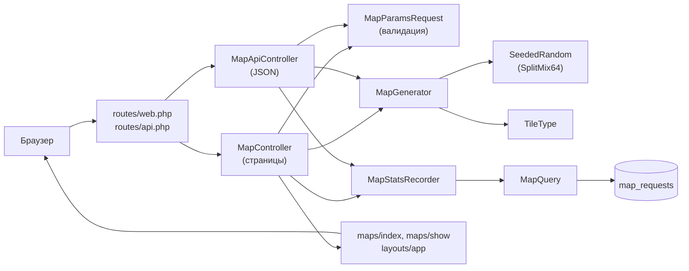

# Архитектура Procedural Map Seed Server

Документ описывает реализацию сервиса генерации процедурных карт по сид-значениям: структуру приложения, путь обработки запроса, хранение статистики и принятые решения.

## 1. Общая структура

Приложение построено на Laravel 13 по схеме MVC с выделенным слоем сервисов. Генерация карты вынесена из контроллеров в `app/Services/MapGen`, запись статистики — в `app/Services/MapStats`. Контроллеры только принимают запрос, вызывают сервисы и возвращают ответ.

### Назначение компонентов

| Слой / компонент | Файлы | Ответственность |
| --- | --- | --- |
| Маршруты | `routes/web.php`, `routes/api.php` | Связывают URL с контроллерами. |
| Контроллеры | `MapController`, `Api/MapApiController` | Принимают запрос, вызывают сервисы, возвращают HTML или JSON. |
| Валидация | `MapParamsRequest` | Проверяет сид (целое в диапазоне `int`) и параметры области. |
| Генерация | `MapGenerator`, `SeededRandom`, `TileType` | Вычисляет тип каждой клетки по сиду и координатам. |
| Статистика | `MapStatsRecorder` | Атомарно увеличивает счётчик обращений к области карты и возвращает их общее число. |
| Модель | `MapQuery` | Работает с таблицей `map_requests`. |
| Представления | `layouts/app.blade.php`, `maps/index`, `maps/show` | Формируют HTML. Стили находятся в `public/css/app.css`, сборка не требуется. |

## 2. Обработка запроса

**Страница карты** (`GET /maps/{seed}`):

1. `MapParamsRequest` проверяет сид и параметры области; при ошибке пользователь возвращается на форму.
2. `MapStatsRecorder` записывает обращение в `map_requests`.
3. `MapGenerator` строит сетку тайлов.
4. Blade-шаблон выводит сетку и легенду.

**API** (`GET /api/maps/{seed}`):

1. Та же валидация через `MapParamsRequest`; при ошибке возвращается JSON с описанием ошибок и кодом 422.
2. Статистика записывается до генерации. Это важно для будущего кэша: кэш должен находиться после записи, иначе повторные запросы перестанут учитываться.
3. Ответ содержит поля `seed`, `x`, `y`, `width`, `height` и массив `tiles`, где каждая строка карты — массив строк типов тайлов (`water`, `plain`, `forest`, `mountain`).

## 3. Хранение данных

Карты не хранятся в базе. Один и тот же сид с одними координатами и размером всегда даёт одну и ту же карту, поэтому её достаточно восстановить по параметрам. Это решение экономит место и исключает расхождение между сохранённой и вычисленной картой.

В базе хранится только статистика.

**Таблица `map_requests`:**

| Поле | Тип | Назначение |
| --- | --- | --- |
| `seed` | integer | Сид карты |
| `origin_x`, `origin_y` | integer | Координаты левого верхнего угла области |
| `width`, `height` | integer | Размер области в клетках |
| `hits` | integer | Число обращений |
| `created_at`, `last_requested_at` | timestamp | Первое и последнее обращение |

Уникальный индекс по `(seed, origin_x, origin_y, width, height)` гарантирует одну строку на область.

Запись обращения выполняется в транзакции:

1. Сначала `insertOrIgnore` создаёт строку с `hits = 0`, если её ещё нет.
2. Затем счётчик увеличивается одним атомарным запросом `hits = hits + 1`.

Корректность при повторных обращениях обеспечивает уникальный индекс: без него вставка создала бы дубликат.

Учитываются только валидные обращения к страницам и API. Перенаправление с формы поиска и ошибочные запросы не записываются.

## 4. Принятые решения

- **Генератор SplitMix64, а не `mt_rand`.** Результат не зависит от версии PHP, поэтому одна и та же карта воспроизводится на разных окружениях. Значение клетки вычисляется напрямую от сида и координат, поэтому карту можно строить частями в любом порядке.
- **Модель `MapQuery`, а не `MapRequest`.** Классы валидации в проекте называются `...Request` (например, `MapParamsRequest`), поэтому модель назвали иначе, чтобы не путать их с записями в базе.
- **Общий подсчёт для страниц и API.** Одна строка на область, независимо от того, откуда пришёл запрос. Поле источника пока не добавлено.
- **Один слой сервисов.** Генерация не зависит от HTTP и используется в консольной команде `map:show` без изменений.

## 5. Ограничения

- Кэш JSON-ответов пока не реализован.
- Статистика не разделяет веб-обращения и API-обращения.
- Сервис рассчитан на локальный запуск и учебное использование, а не на публичную эксплуатацию.
